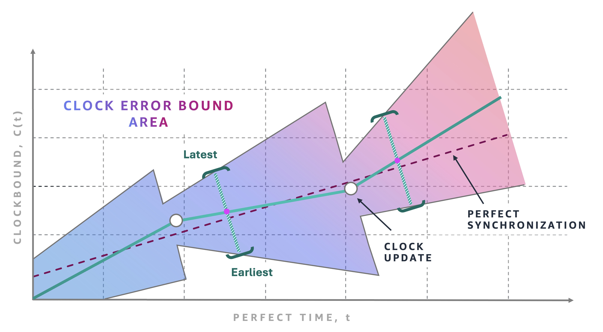

# ClockBound

## Summary

ClockBound is a solution to synchronize your Operating System clock and determine a consistent order of events across
distributed nodes.

Most users will be interested in the ClockBound daemon and library as a cohesive system:

- The clockbound daemon that keeps the system clock synchronized by accessing local PTP Hardware Clock (PHC) device or
  NTP sources, and offers extra information over a shared memory segment.
- The libclockbound library that offers a clockbound client to timestamp events with rich information, reading from the clockbound daemon.

Optionally, the clockbound-ff-tester let's you simulate or replay previous runs of the daemons to assess its correctness.

To determine a consistent order of events across nodes, applications must use the client offered by libclockbound. For
every event of interest the client reports a window of uncertainty and the status of the clockbound daemon:

- The window of uncertainty (the Clock Error Bound) is defined by two timestamps (earliest, latest) within which true time exists.
- The status is a code indicated whether the daemon is synchronized, free running, etc.

Using ClockBound with a consistent, trusted time service will allow you to compare timestamps to determine order and
consistency for events and transactions, independent from the nodes respective geographic locations.

We recommend you use the Amazon Time Sync Service, a highly accurate and reliable time reference that is natively
accessible from Amazon EC2 instances, to get the most out of ClockBound on your AWS infrastructure. For more information
on the Amazon Time Sync Service and configuration with PTP Hardware Clocks or the NTP endpoints, see the
[EC2 User Guide](https://docs.aws.amazon.com/AWSEC2/latest/UserGuide/set-time.html).

Note that the clockbound daemon automatically detects and configure the reference time sources available.

## Reasons to use ClockBound

- Distributed System Consistency: Make reliable ordering decisions for events across geographically distributed systems
- Bounded Uncertainty: Get timestamps with error bounds to support your application business logic
- High Performance: Access time information through efficient shared memory without system calls
- Multiple Time Sources: Leverage NTP, PHC, and VMClock sources for robust time synchronization
- AWS Integration: Optimized for use with Amazon Time Sync Service on EC2 instances

## The Clock Error Bound

The Clock Error Bound is a measure of clock accuracy. It is defined against reference time (UTC time, an idealized "true
time"), and represents the maximum difference between the local time on your computer and the reference time.

The ClockBound daemon and client implement the calculation of this bound, which accounts for the clock error that
accumulates between reliable reference clocks and your computer. Reference clocks currently supported include Network
Time Protocol (NTP) servers, a local PTP Hardware Clock (PHC) device, or a VMClock device if available.

ClockBound implements a calculation that is specific to each type of reference clock. For NTP sources, for example, the
clock error bound relies on three measurements defined by the protocol:

- Local offset (the system time): The residual adjustment to be applied to the operating system clock.
- Root dispersion: The accumulation of clock drift at each NTP server on the path to the reference clock.
- Root delay: The accumulation of network delays on the path to the reference clock.

The clock error bound is calculated using the formula below:

> Clock Error Bound = |Local Offset| + Root Dispersion + (Root Delay / 2)

The window of uncertainty is defined as the time reported by the clockbound daemon +/- the clock error bound.

The figure below illustrates how the clock error bound grows in between clock updates. At any point, a clockbound client
can read a pair of timestamps that bound the clock error.



Figure 1: The Clock Error Bound provides a bound on the local clock error with regard to “true time”.

Note that ClockBound reports on clock accuracy is not a clock offset against the sources it tracks to keep your local
clock synchronized. Instead, it reports on the worse case scenario: the sum of all errors from reference time to your
computer. Therefore, the clock error bound is a general metric to compare timestamps across nodes, independent from
their location or the synchronization protocol they use.

## Getting Started

To use ClockBound, you must run the ClockBound daemon and make use of a ClockBound client to communicate with
the daemon. ClockBound clients are provided as a Rust crate and C library.

### Install the daemon using release binaries

Download pre-built binaries from the GitHub releases page. The releases include RPM packages for x86_64 Linux and
aarch64 Linux architectures.

```bash
# Install RPM package (RHEL/CentOS/Amazon Linux)
sudo rpm -i clockbound-*.rpm

# Start the daemon
sudo systemctl enable clockbound
sudo systemctl start clockbound
```

More information on the daemon can be found here in [ClockBound Daemon](./docs/clockbound-daemon.md) - A daemon to provide
clients with an error bounded timestamp interval.

### Use the rust client

Set up your application's `Cargo.toml` so it looks like this:

```toml
[dependencies]
clock-bound = "3.0.0-beta.1"
```

And then the code:

```rust
use clock_bound::client::ClockBoundClient;

let mut client = ClockBoundClient::new()?;
let result = client.now()?;
println!("Time range: {:?} to {:?}", result.earliest, result.latest);
```

For more information on the rust client, check out [ClockBound Client Rust](./docs/rust-client.md) - A Rust client crate
to create bounded timestamps synchronized by the ClockBound daemon. (Or better yet, we should just move this info into
the docs.rs page)

#### C Client

```c
#include <clockbound.h>

clockbound_now_result now;
clockbound_err cb_err;
clockbound_ctx *ctx;

ctx = clockbound_open(&cb_err);

clockbound_now(ctx, &now, &cb_err);

printf("Time range: %ld.%09ld to %ld.%09ld\n",
       now.earliest.tv_sec, now.earliest.tv_nsec,
       now.latest.tv_sec, now.latest.tv_nsec);
```

For more information see [ClockBound FFI library](./docs/clockbound-ffi.md) - A C client library to create bounded
timestamps synchronized by the ClockBound daemon, and examples provided.

#### Custom Client

[ClockBound Protocol](./docs/protocol.md) - Reference provided to create a custom client. Clients can be created in any
programming language that can read from a shared memory segment that is backed by a file.

## Security

See [CONTRIBUTING](CONTRIBUTING.md#security-issue-notifications) for more information.

## License

This project is distributed under the following 2 licenses:

- MIT License
- Apache License 2.0

These are included as LICENSE.MIT and LICENSE.Apache-2.0 respectively. You may use this software under the terms of any
of these licenses, at your option.
