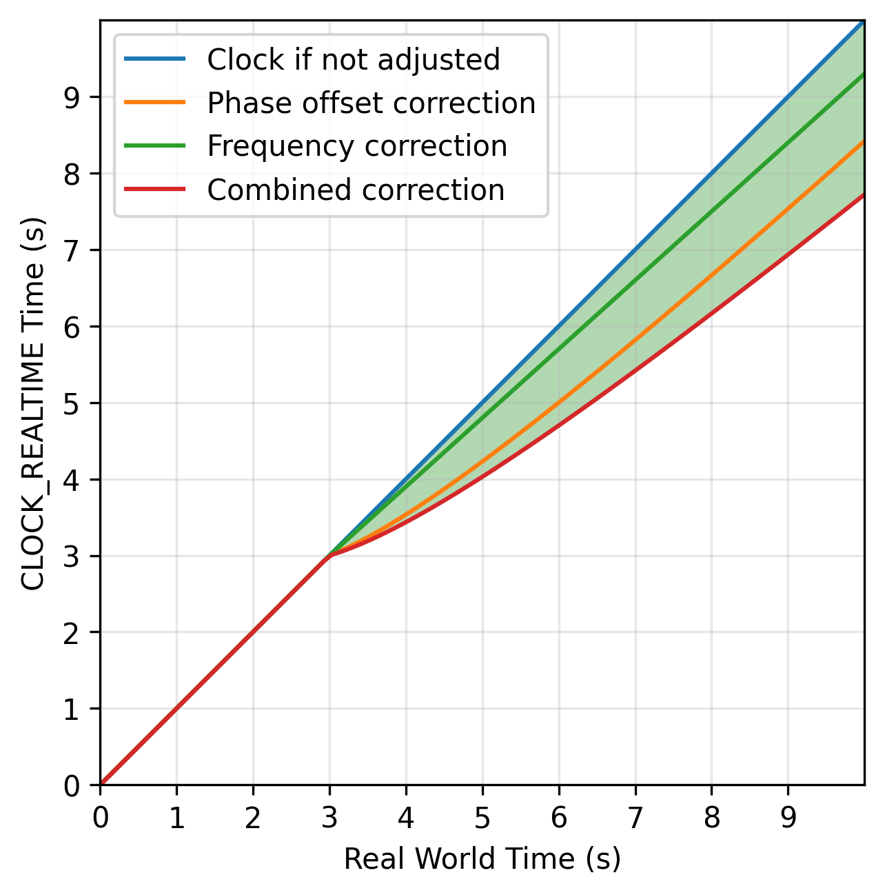
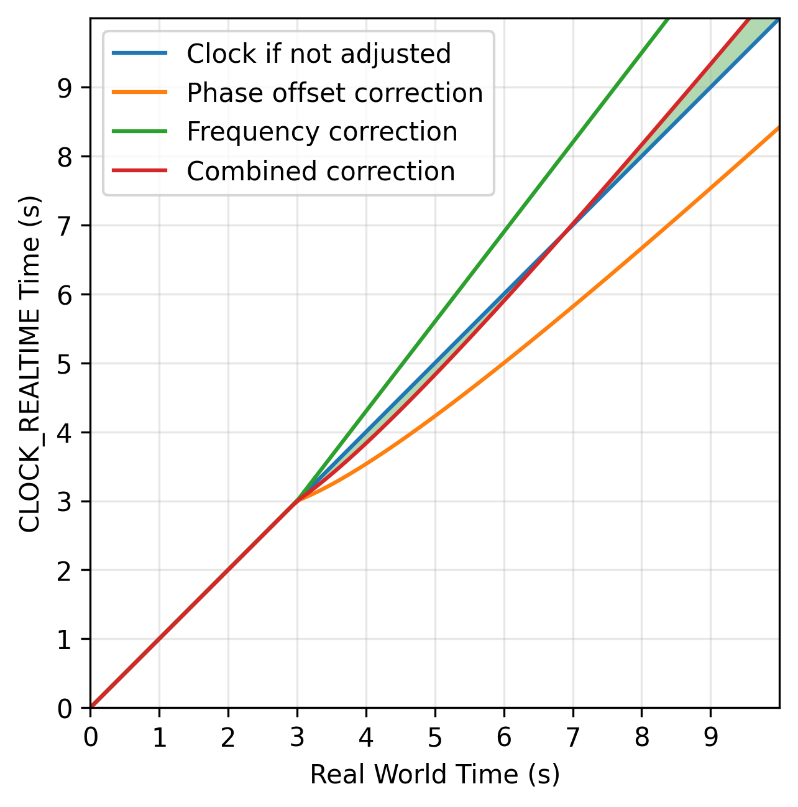

# Test program: `adjust-clock-test`

This directory contains the source code for a test program `adjust-clock-test`.

### `adjust-clock-test`
`adjust-clock-test` is a test program validating that the phase correction and frequency correction utilities implemented in `ClockAdjust`
work as expected. **To ensure valid results, ensure that no time sync daemon is currently disciplining the clock.**

It asserts the following:
 - We can modify the frequency of the clock via ClockAdjust. We expect the rate of CLOCK_REALTIME to approximately match our inputs, with some room for error due to jitter and wander.
 - We can modify the phase offset of the clock via ClockAdjust. We expect the rate of CLOCK_REALTIME to speed up or slow down to our inputs, with some room for error due to jitter and wander.

To do so, the implementation does these setup steps:
1. Reset the kernel NTP parameters via `adjtimex`. `CLOCK_REALTIME` should then tick at the same rate as `CLOCK_MONOTONIC_RAW`, but with a large phase offset.
2. Calculate the offset between `CLOCK_REALTIME` and `CLOCK_MONOTONIC_RAW`. This will be used as a baseline for determining how our `ClockAdjust` component is steering
   the clock.

Then, each test does:
1. Perform an adjustment of the clock via `ClockAdjust`, and continually calculate the offset of `CLOCK_REALTIME` and `CLOCK_MONOTONIC_RAW`, ensuring that this offset
   is steered in the direction intended by the clock adjustment. We should be able to estimate the offset of these two clocks at some given time based on our parameters.

This is diagrammed below - we are trying to estimate the offset of `Clock if not adjusted` and the `Combined Correction`, after we call into `ClockAdjust`.

| Description | Image |
|---|---|
|A plot where skew and phase correction parameters are negative, causing our offset to be negative.||
|A plot where the skew parameter is positive and phase correction is negative. Harder to understand with opposite signs.||


## Prerequisites

The program must be run as a user with sufficient permissions to adjust the clock (generally `root`).

Currently only Linux is supported.

## Building with Cargo

Run the following command to build the example programs.

```
cargo build --release
```

## Running `adjust-clock-test`

The build artifact should show up at
```
./target/release/adjust-clock-test
```

You can run the command like below, and the output should look similar:
```
$ ./target/release/adjust-clock-test    
2025-10-24T17:39:50.676899Z  INFO adjust_clock_test: Resetting clock parameters..
2025-10-24T17:39:51.677761Z  INFO adjust_clock_test: Running test with phase correction +0.000000000s and skew +0.000000000 and allowed diff of expected vs measured 0.000010000s
2025-10-24T17:39:51.677820Z  INFO adjust_clock_test: Test start time is 2025-10-24T17:39:51.677810217Z and initial `CLOCK_REALTIME` <---> `CLOCK_MONOTONIC_RAW` offset is 1760213155.9888163s
2025-10-24T17:40:01.428996Z  INFO adjust_clock_test: Test passed!
2025-10-24T17:40:01.429123Z  INFO adjust_clock_test: | Event Timestamp | Expected Change In Offset | Measured Change In Offset | Measurement RTT | Expected - Measured |
| ----------------| --------------------------| --------------------------| ----------------| --------------------|
| 2025-10-24T17:39:51.678936928Z | +0.000000000 | +0.000000232 | +0.000000271 | -0.000000232 |
| 2025-10-24T17:39:51.929307255Z | +0.000000000 | +0.000000231 | +0.000000289 | -0.000000231 |
| 2025-10-24T17:39:52.178717116Z | +0.000000000 | +0.000000236 | +0.000000287 | -0.000000236 |
| 2025-10-24T17:39:52.429095764Z | +0.000000000 | +0.000000243 | +0.000000315 | -0.000000243 |
| 2025-10-24T17:39:52.679471608Z | +0.000000000 | +0.000000267 | +0.000000371 | -0.000000267 |
| 2025-10-24T17:39:52.928861091Z | +0.000000000 | +0.000000269 | +0.000000365 | -0.000000269 |
| 2025-10-24T17:39:53.179252162Z | +0.000000000 | +0.000000270 | +0.000000377 | -0.000000270 |

[..more output..]
```
